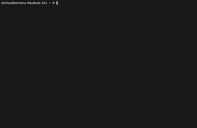

# agent-todo

**Task tracking for AI agents — local SQLite, MCP tools, one machine daemon**

TypeScript MCP server so agents can create, claim, update, and comment on tasks. Work stays on your machine through a loopback daemon (no cloud server in this product).

**Docs:** [Quick start](./docs/quick-start.md) · [Tool reference](./docs/tool-reference.md) · [Agent conventions](./docs/agent-conventions.md) · [Self-hosting](./docs/self-hosting.md)

## Contents

- [Get started](#get-started)
- [How it works](#how-it-works)
- [Supported platforms](#supported-platforms)
- [Supported agents](#supported-agents)
- [Environment variables](#environment-variables)
- [Uninstall](#uninstall)
- [Troubleshooting](#troubleshooting)
- [Development](#development)
- [Packages](#packages)

## Get started

### 1. Install the CLI

One command downloads the right build for your OS and installs into `~/.local/bin` (macOS/Linux) or your user path (Windows):

```bash
# macOS / Linux
curl -fsSL https://raw.githubusercontent.com/DaltonVector-ai/agent-todo/main/scripts/install.sh | sh
```

```powershell
# Windows (PowerShell)
irm https://raw.githubusercontent.com/DaltonVector-ai/agent-todo/main/scripts/install.ps1 | iex
```

Set `AGENT_TODO_RELEASE_BASE_URL` to override the download base (default: `https://github.com/DaltonVector-ai/agent-todo/releases/latest/download`).

<details>
<summary>Manual install from GitHub Releases</summary>

Download a binary from [GitHub Releases](https://github.com/DaltonVector-ai/agent-todo/releases/latest), rename it to `agent-todo` (or `agent-todo.exe` on Windows), and put it on your `PATH`.

| Platform | Release asset | Install as |
| --- | --- | --- |
| macOS (Apple silicon) | `agent-todo-darwin-arm64` | `agent-todo` |
| macOS (Intel) | `agent-todo-darwin-x64` | `agent-todo` |
| Linux x64 | `agent-todo-linux-x64` | `agent-todo` |
| Linux arm64 | `agent-todo-linux-arm64` | `agent-todo` |
| Windows x64 | `agent-todo-windows-x64.exe` | `agent-todo.exe` |

</details>

If the installer added a new directory to your path, open a **new terminal** so `agent-todo` resolves before the next step.

To check for updates later, run `agent-todo upgrade` (it prints the release URL and install options).

### 2. Wire up your agent(s)

`install` starts (or connects to) the machine daemon, enables login autostart when you host locally, and writes MCP config for agents it finds on this machine.

```bash
agent-todo install
```



The interactive flow asks whether to **start a new server** on this machine or **connect to an external server**.

<details>
<summary>Install with flags (scripts, CI, or advanced options)</summary>

```bash
# Host the SQLite daemon on this machine (loopback)
agent-todo install --local

# Listen on the LAN while MCP on this machine still uses loopback
agent-todo install --local --network

# Use a daemon that already runs elsewhere
agent-todo install --url https://your-host:8787
```

Wire specific agents with `--agent` (repeatable). Agent ids: `claude-code`, `cursor`, `codex`, `gemini`, `vscode`, `opencode`.

</details>

`install` configures each agent to run `agent-todo serve --mcp` (stdio to the daemon). It does **not** register a project; that is step 3.

### 3. Initialize each project

In the repository your agents should work on:

```bash
cd your-project
agent-todo init
```

`init` registers the directory on the machine daemon and writes the **project code** and **default group id** into `AGENTS.md` (between `<!-- agent-todo:start -->` and `<!-- agent-todo:end -->`).

Use the **project code** to list or create groups, the **group id** to list or create what is inside a group, and the **task id** alone to read or update one task.

Set who is claiming work:

```bash
export AGENT_TODO_AGENT=my-agent-name
```

### 4. Work through MCP

With install complete, your agent client already points at the `agent-todo` MCP server. Typical flow:

1. Call **`task_next`** with your group id (from `init`) and `claim: true`.
2. Use **`task_status`** and **`comment_add`** as you work; see [agent conventions](./docs/agent-conventions.md).
3. If you run MCP manually: `agent-todo serve --mcp`.

Multiple machines sharing one daemon: `agent-todo install --url <base>`. See [self-hosting](./docs/self-hosting.md).

## How it works

- **Machine daemon** — SQLite-backed HTTP server on the host (default `http://127.0.0.1:8787`). It stays up with no idle shutdown when you host locally.
- **Machine database** — under `~/.agent-todo/` (override with `AGENT_TODO_DB`).
- **Per-repo config** — `.agent-todo/config.toml` after `init`; optional read-only board via the daemon.
- **MCP toolsets** — default `core`; set `AGENT_TODO_TOOLSETS` to a comma-separated list (see [tool reference](./docs/tool-reference.md)).

## Supported platforms

Release binaries are built for **macOS** (x64 and arm64), **Linux** (x64 and arm64), and **Windows** (x64). The install scripts support macOS and Linux only; on Windows use the PowerShell script or a manual download.

## Supported agents

`agent-todo install` detects and can configure:

| Agent id | Label |
| --- | --- |
| `claude-code` | Claude Code |
| `cursor` | Cursor |
| `codex` | Codex CLI |
| `gemini` | Gemini CLI |
| `vscode` | VS Code Copilot |
| `opencode` | opencode |

Only agents that are detected are configured unless you pass `--agent`.

## Environment variables

| Variable | Purpose |
| --- | --- |
| `AGENT_TODO_AGENT` | Actor name for claims and audit entries |
| `AGENT_TODO_DB` | Machine SQLite database path (tests and overrides) |
| `AGENT_TODO_PROJECT` | Override project discovery (`.agent-todo` path or repo root) |
| `AGENT_TODO_DAEMON_URL` | Machine daemon base URL (default `http://127.0.0.1:8787`) |
| `AGENT_TODO_TOOLSETS` | Comma-separated MCP toolsets (default: `core`) |
| `AGENT_TODO_RELEASE_BASE_URL` | Override release download base for install scripts |

## Uninstall

Remove agent MCP wiring, stop the local daemon, and remove login autostart:

```bash
agent-todo uninstall
```

Per repository, remove project wiring (data kept unless you opt in):

```bash
agent-todo uninit          # keeps .agent-todo data by default
agent-todo uninit --wipe-data
```

## Troubleshooting

```bash
agent-todo doctor
```

Checks the binary on `PATH`, machine client URL and daemon health, agent MCP entries, and `.agent-todo` discovery from the current directory.

## Development

Requires [Bun](https://bun.sh) 1.4 or newer.

```bash
git clone https://github.com/DaltonVector-ai/agent-todo.git
cd agent-todo
bun install
```

From this checkout, prefix CLI commands with `bun run cli --` (for example `bun run cli -- install --local`).

### Scripts

| Command | What it does |
| --- | --- |
| `bun run test -- --timeout 60000` | Run the suite CI runs (package sources and integration tests) |
| `bun run lint` | Biome check |
| `bun run typecheck` | `tsc -b` across packages |
| `bun run cli -- --help` | Print CLI usage |
| `bun run build:bin` | Compile a host binary under `dist/bin/` |
| `bun run build:bin:all` | Build the linux/mac/windows matrix |

`--help` lists `install`, `uninstall`, `init`, `uninit`, `doctor`, `upgrade`, `daemon`, `serve`, `migrate`, `import`, and `export`. Unknown commands exit **1**.

### Binary builds

`bun run build:bin` compiles for the current host (`dist/bin/agent-todo-<os>-<arch>[.exe]`).
`bun run build:bin:all` builds the linux and macOS x64 and arm64 binaries and the Windows x64 binary.
Release tags run [.github/workflows/release.yml](./.github/workflows/release.yml) (binaries, `SHA256SUMS`, SBOM, GHCR image).

## Packages

| Package | Role |
| --- | --- |
| `@agent-todo/cli` | CLI and machine-daemon commands |
| `@agent-todo/server` | HTTP server and machine daemon |
| `@agent-todo/mcp` | MCP tools |
| `@agent-todo/core` | Domain types and services |
| `@agent-todo/store-sqlite` | Machine database |
| `@agent-todo/web` | Read-only board |
| `agent-todo` (`packages/npm-wrapper`) | npm binary wrapper |
