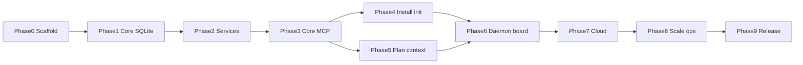

# agent-todo — Phase implementation plans

Cursor-buildable plans for implementing [project_doc.md](../../project_doc.md). Each `*.plan.md` is self-contained: open a fresh Agent chat, point it at one file, and build only that phase.

## How to build a phase in Cursor

1. Confirm the previous phase’s **Done when** section is satisfied (tests green, artefacts present).
2. Open a new Agent chat (Agent mode, not Plan mode).
3. Paste this prompt, substituting the phase file:

```text
Implement only the plan in docs/plans/NN-….plan.md.
Stop when its Done when section passes.
Do not start the next phase.
Source of truth for contracts: project_doc.md.
```

4. Review the diff; run the phase’s test commands yourself if the agent did not.
5. Commit that phase before starting the next.

**Rule:** one phase per Agent session, in numeric order. Do not implement phase N+1 in the same session.

## Build order

| Phase | File | Est. | Depends on | Done when (one line) |
| --- | --- | --- | --- | --- |
| 0 | [00-scaffold.plan.md](00-scaffold.plan.md) | 1.5 d | — | `bun test` and typecheck pass in CI; `bun run cli -- --help` prints commands |
| 1 | [01-core-sqlite.plan.md](01-core-sqlite.plan.md) | 3 d | 0 | Status unit tests + 1,000 concurrent KEY-N allocations; SqliteStore conformance green |
| 2 | [02-services.plan.md](02-services.plan.md) | 3 d | 1 | Full lifecycle + reopen via services; parallel `next` never double-claims |
| 3 | [03-core-mcp.plan.md](03-core-mcp.plan.md) | 3 d | 2 | Core MCP tools work; schema ≤ 1.8k tok; line list ≤ 600 tok — **local MVP** |
| 4 | [04-installer-init.plan.md](04-installer-init.plan.md) | 3 d | 3 | `install` + `init` wires agents; worktrees share one board; uninstall restores configs |
| 5 | [05-planning-context.plan.md](05-planning-context.plan.md) | 3 d | 3 (run after 4) | Plan/admin tools, import/export, compaction meet token budgets |
| 6 | [06-daemon-board.plan.md](06-daemon-board.plan.md) | 2.5 d | 4, 5 | 30 agents, no SQLITE_BUSY / duplicate claims; board ≤ 1 s lag |
| 7 | [07-cloud.plan.md](07-cloud.plan.md) | 5 d | 6 | Push preserves IDs; multi-machine share; RLS token scope proven — **team-ready** |
| 8 | [08-scale-ops.plan.md](08-scale-ops.plan.md) | 4 d | 7 | k6: p95 &lt; 100 ms, zero duplicate claims; deploy kits present |
| 9 | [09-hardening-release.plan.md](09-hardening-release.plan.md) | 2 d | 8 | Budget CI, docs, release artefacts, dogfood checklist — **v1.0** |



Phases 4 and 5 both depend on phase 3. **Do them in numeric order** (4 then 5). Phase 4 uses the ContextService API from phase 2 for first-group import; phase 5 exposes full MCP/CLI import-export and plan/admin tools.

## Locked decisions

These override open questions and stale checklist items in the spec. Every phase plan assumes them.

### Stack (override §9 phase 0 checklist)

- **Bun** workspace, `bun test`, `bun build --compile`. Not pnpm; not a Node 22 test job.
- **Kysely** + `bun:sqlite`. Not Drizzle; not `better-sqlite3`.
- Packages under `packages/*` as in project_doc §8. Not a single `src/index.ts`.
- Install early: `zod`, `ulid`, `@modelcontextprotocol/sdk`. Add Hono, `postgres`, Vite, OTel only in the phase that first needs them.

### Product (resolve §10.4)

- **`terminal_status` on groups:** `verified` | `deployed`, default `deployed`. Column added in SQLite schema phase 1. When `terminal_status = verified`, `verified → deploying` requires `force: true` + `reason`.
- **No `blocked` status.** Use comment kind `blocker` plus status `todo` or `reopen`.
- **Cloud v1 is self-hosted only** (Docker Compose, Helm, Terraform, Fly). No signup or billing. Org/project tenancy and RLS still ship in phase 7.

## Spec map

| Concern | Spec section |
| --- | --- |
| Architecture, modes, config | §2, §2b |
| IDs, entities, status, SQL | §3 |
| Context minimisation / Shaper | §4 |
| MCP tools, resources, prompts | §5 |
| Group context sections | §6 |
| Claims, versioning, security, scale | §7 |
| Monorepo layout | §8 |
| Phase checklists and done-when | §9 |
| Testing and risks | §10 |

## Plan file format

Each phase file starts with Cursor plan YAML frontmatter (`name`, `overview`, `todos`, `isProject: true`) so Cursor can render and build it. The markdown body follows a fixed outline: Goal, Prerequisites, Out of scope, Locked decisions, File tree, Implementation, Tests, Done when.
